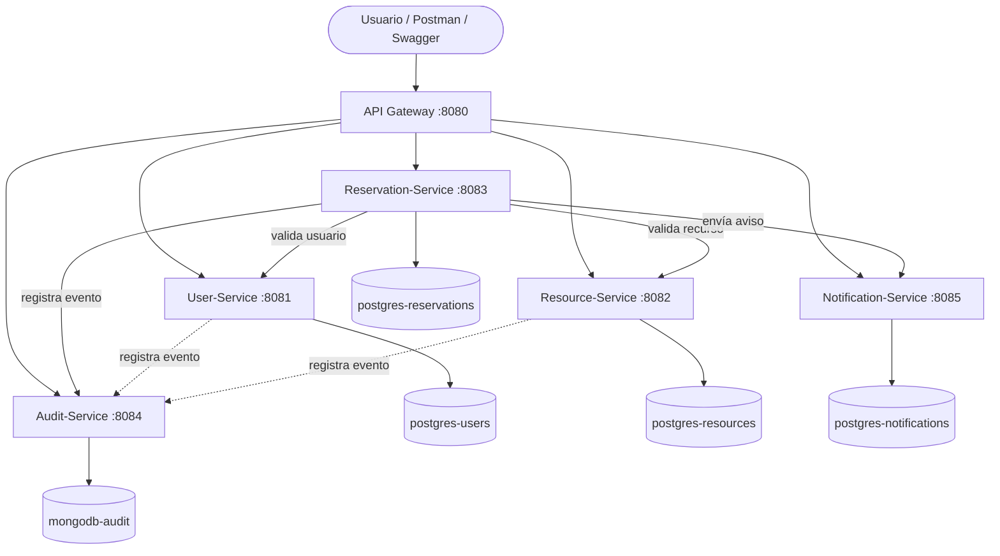

# Arquitectura General

## Diagrama (Mermaid)



## Flujo "Crear reserva"

```mermaid
sequenceDiagram
    participant C as Cliente
    participant G as API Gateway
    participant R as Reservation-Service
    participant U as User-Service
    participant S as Resource-Service
    participant A as Audit-Service
    participant N as Notification-Service

    C->>G: POST /reservations
    G->>R: reenvía la petición
    R->>U: GET /users/{id}  (¿existe y está activo?)
    R->>S: GET /resources/{id}  (¿existe y está DISPONIBLE?)
    R->>R: ¿se cruza con otra reserva? (si sí: 409)
    R->>R: guarda la reserva como APROBADA
    R->>A: POST /audit  (obligatorio; si falla, se revierte todo)
    R->>N: POST /notifications  (si falla, solo queda en el log)
    R-->>C: 201 CREATED
```

## Manual técnico (resumen)

| Servicio | Puerto | Base de datos | Responsabilidad |
|---|---|---|---|
| api-gateway | 8080 | — | Punto único de entrada, reenvía según la ruta |
| user-service | 8081 | PostgreSQL `users_db` | Usuarios y roles, valida correo institucional |
| resource-service | 8082 | PostgreSQL `resources_db` | Catálogo de recursos y su estado |
| reservation-service | 8083 | PostgreSQL `reservations_db` | Reservas, reglas de negocio y orquestación |
| audit-service | 8084 | MongoDB `audit_db` | Historial de operaciones (solo se agrega y se consulta) |
| notification-service | 8085 | PostgreSQL `notifications_db` | Notificaciones e historial |

### Decisiones de diseño
- **Una base de datos por servicio**: ningún servicio lee las tablas de otro; se hablan solo por REST.
- **Correo institucional**: el dominio válido se configura con la variable `EMAIL_DOMAIN` (por defecto `universidad.edu.co`).
- **Reserva**: si el usuario existe, el recurso está DISPONIBLE y no hay cruce de horario, se crea directamente como APROBADA.
- **Cancelar (DELETE)**: no borra la fila, cambia el estado a CANCELADA para conservar la trazabilidad.
- **Auditoría**: en reservas es obligatoria (transacción con rollback). En usuarios/recursos es "mejor esfuerzo".
- **FINALIZADA**: una tarea programada marca cada minuto las reservas aprobadas cuya hora de fin ya pasó.
- **Errores**: todos los servicios devuelven el mismo JSON de error (400, 404, 409, 500; 502 si otro servicio falla).
- **Extras sobre el enunciado**: `POST /audit` (los servicios lo usan para registrar), `GET /audit/referencia/{ref}` y `GET /reservations/{id}/completa`.
